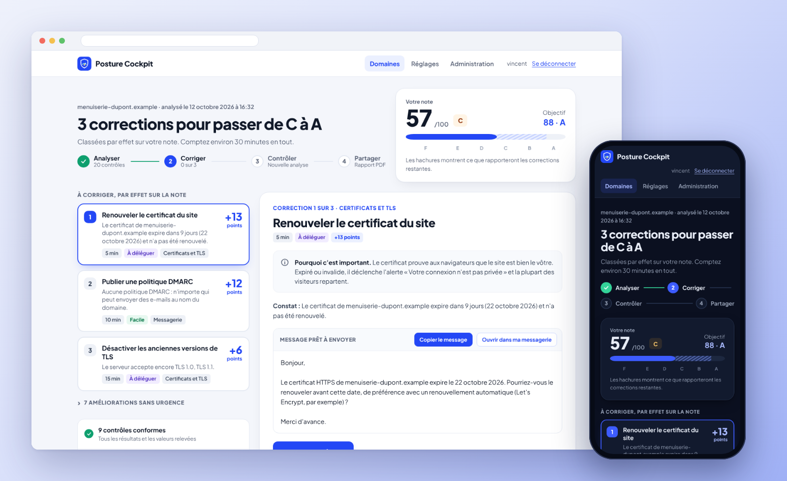
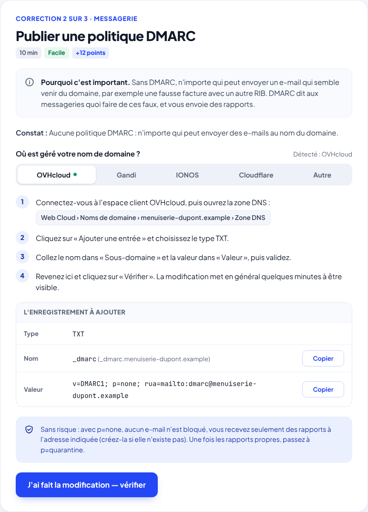
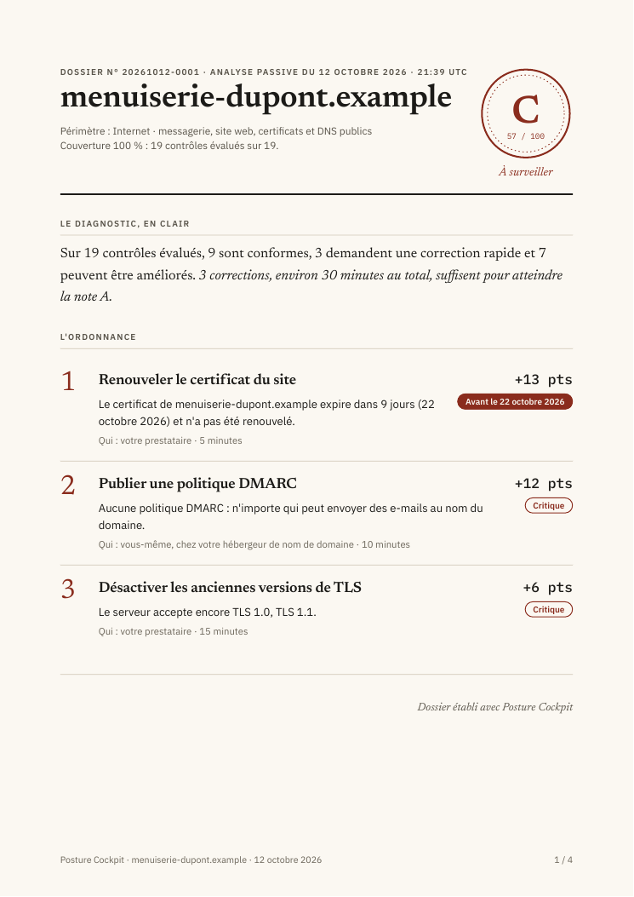
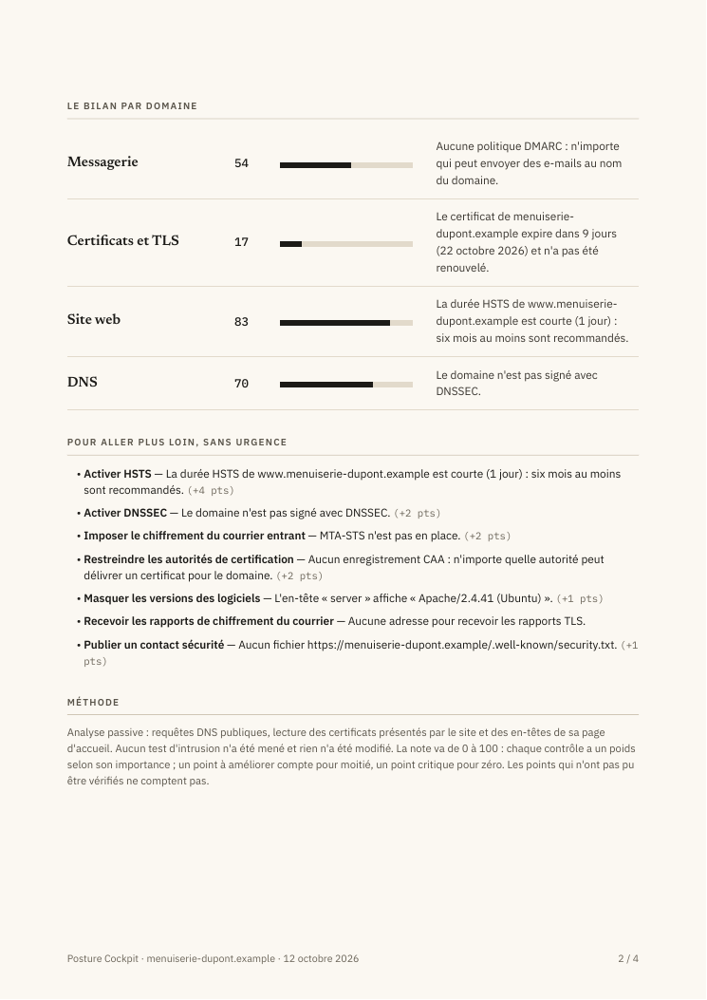

<div align="center">

# 🛡️ Posture Cockpit

### Votre site fonctionne, vos e-mails arrivent… mais votre nom de domaine est-il bien protégé ?

**Comprendre · Corriger · Vérifier · Suivre dans le temps**

**Français** · [**English**](README.md)

  



<sub>Les captures présentent le domaine fictif <code>menuiserie-dupont.example</code>. Il s'agit d'une démonstration, pas des résultats d'une entreprise réelle.</sub>

</div>

---

## Posture Cockpit, c'est quoi ?

Quand on possède un site Internet ou une adresse e-mail liée à son nom de domaine, on pense rarement aux réglages de sécurité qui se cachent derrière. Tant que le site s'ouvre et que les messages arrivent, tout semble fonctionner.

Pourtant, un certificat peut approcher de sa date d'expiration, un site peut manquer de certaines protections, ou un domaine peut être insuffisamment protégé contre l'usurpation d'adresse e-mail.

**Posture Cockpit aide à faire le point.** Vous lui indiquez un nom de domaine et il examine les protections qu'il peut observer : **site web, certificats HTTPS, messagerie et DNS**. Il vous présente ensuite un bilan compréhensible, avec les points à surveiller et, lorsque c'est possible, les démarches pour les corriger.

L'idée est simple : **ne pas seulement vous dire qu'il y a un problème, mais vous aider à comprendre ce qu'il signifie et quoi faire ensuite.**

C'est un logiciel librement consultable sur GitHub, que vous installez **sur votre propre serveur**. Il ne nécessite ni ChatGPT, ni abonnement à un service d'IA.

## À qui ça peut servir ?

À une personne qui gère son propre domaine, à un **artisan, une association, une petite entreprise ou une collectivité** qui possède un site ou des adresses e-mail, mais aussi à l'informaticien ou au prestataire qui les accompagne.

Vous n'avez pas besoin de maîtriser SPF, DMARC ou TLS pour lire le bilan. Et si vous connaissez déjà ces technologies, les résultats détaillés et les références techniques restent accessibles.

## Un exemple, pour comprendre

Imaginons une menuiserie qui utilise le domaine `menuiserie-dupont.example` pour son site et ses e-mails.

Le site est accessible. Les clients peuvent écrire à l'entreprise. Mais comment savoir si quelqu'un risque d'envoyer de faux messages en se faisant passer pour elle, ou si le site utilise les protections HTTPS attendues ?

Avec Posture Cockpit :

1. **On ajoute le domaine** et on lance l'analyse.
2. **On découvre le bilan** : ce qui est correct, ce qui mérite d'être amélioré et ce qui n'a pas pu être vérifié.
3. **On consulte les explications** : pourquoi ce réglage compte-t-il ? Peut-on agir soi-même ou faut-il contacter son prestataire ?
4. **On effectue la correction**, puis on utilise le bouton de vérification pour voir si elle a réellement été prise en compte.
5. **On garde un œil sur la suite**, grâce aux historiques et aux analyses programmées.

Par exemple, si la configuration DMARC mérite d'être renforcée, Posture Cockpit explique à quoi elle sert et peut proposer une première étape. Il ne change rien à votre place : **vous gardez la main**, et certaines protections doivent être mises en place progressivement pour ne pas perturber les e-mails légitimes.

## Ce que vous trouverez dans l'application

### Un bilan facile à lire

Posture Cockpit indique les protections correctement configurées, les points critiques et les vérifications qui n'ont pas pu aboutir. Il affiche aussi une **note accompagnée d'un taux de couverture** : on sait ainsi sur quelle part des contrôles repose le résultat.

**Une note de 90/100 ne veut pas dire que votre entreprise est sécurisée à 90 %.** Elle résume seulement les points effectivement examinés par l'outil. Posture Cockpit ne remplace pas un audit complet ni un test d'intrusion.

### Des corrections expliquées, pas seulement signalées



Lorsqu'un réglage DNS doit être modifié, l'outil peut vous guider chez **OVHcloud, Gandi, IONOS ou Cloudflare** et préparer les valeurs à copier. Si le problème relève plutôt de votre hébergeur ou de votre agence web, il peut fournir un **message à leur transmettre**.

Les conseils restent à vérifier avant application, en particulier pour la messagerie : une modification DNS mal choisie peut interrompre des envois légitimes.

### Un rapport PDF que l'on peut partager

| Le bilan | Les explications |
|:--:|:--:|
|  |  |

Le rapport commence par l'essentiel : le diagnostic et les corrections proposées. Les détails techniques et les références (notamment **ANSSI** et **RFC**) sont disponibles pour les personnes qui souhaitent aller plus loin.

### Un suivi qui ne s'arrête pas au premier diagnostic

Depuis la **v0.5.0**, Posture Cockpit conserve les résultats successifs, compare les observations compatibles et peut lancer des analyses **quotidiennes, hebdomadaires ou mensuelles**.

Il possède également un centre **Événements** pour retrouver certaines dégradations de sécurité, pertes de couverture et erreurs répétées d'analyses programmées.

**Attention :** les alertes restent dans l'application. Cette version n'envoie pas automatiquement d'e-mails, de SMS ou de notifications externes.

[En savoir plus sur les analyses programmées](docs/user/ANALYSES_PROGRAMMEES.md) · [Comprendre les événements](docs/user/EVENEMENTS.md)

### Mission Control : comprendre ce qui a changé et quoi faire ensuite

Depuis la **v0.6.0**, une vue **Portefeuille** aide à repérer les domaines qui méritent de l'attention. La page **Mission Control** de chaque domaine explique les changements réellement observés, les corrections à privilégier et ce que la dernière analyse n'a pas permis de vérifier.

Avec **« Et si… ? »**, vous pouvez sélectionner plusieurs corrections (y compris les étapes successives de DMARC) et voir ce qui *pourrait* s'améliorer. La simulation **ne modifie ni vos DNS ni vos serveurs** : seule une nouvelle analyse permettra de confirmer le résultat réel.

**Exemple fictif :** [télécharger le rapport PDF Mission Control](docs/examples/posture-cockpit-mission-control-demo.fr.pdf). Rapport généré par la candidate v0.6.1 sur `menuiserie-dupont.example`, sans analyse d’une organisation réelle. Certaines actions ont un effet non déterminable ; les projections restent à confirmer.

## Qu'est-ce que Posture Cockpit vérifie exactement ?

| Partie examinée | En termes simples |
|---|---|
| **Messagerie** | Qui est autorisé à envoyer des e-mails au nom de votre domaine ? Quelles protections contre l'usurpation sont publiées ? L'outil vérifie notamment SPF, DKIM, DMARC, MTA-STS et TLS-RPT, dans les limites de ce qui est observable. |
| **Site web** | Le site redirige-t-il correctement vers HTTPS ? Certaines protections du navigateur sont-elles présentes, comme HSTS et CSP ? |
| **Certificats HTTPS** | Le certificat est-il valide ? Va-t-il bientôt expirer ? Les protocoles TLS et les clés répondent-ils aux exigences contrôlées ? |
| **DNS** | Les serveurs de noms, DNSSEC et les règles CAA sont-ils configurés comme attendu ? |

Au total, **20 contrôles sont intégrés dans la v0.6.1**. Certains sont sans objet pour un domaine donné ; d'autres peuvent ne pas aboutir à cause d'une erreur ou d'un serveur qui ne répond pas. Posture Cockpit fait la différence entre **« non applicable »** et **« impossible à vérifier »** : il ne considère jamais un contrôle non réalisé comme réussi.

[Comprendre le calcul de la note et de la couverture](docs/user/SCORING.fr.md)

## Essayer Posture Cockpit avant d'analyser son domaine

Une **démonstration avec un domaine fictif** est proposée lors de l'initialisation du premier compte. Elle permet de parcourir l'interface, les explications et le rapport sans utiliser un vrai domaine d'entreprise.

Il faut toutefois installer Posture Cockpit pour accéder à cette démonstration : **ce n'est pas un service de démonstration hébergé en ligne**.

## Installation : par où commencer ?

Posture Cockpit fonctionne sur un serveur ou un ordinateur disposant de **Docker Engine** et de **Docker Compose 2.24 ou plus récent**. Des images prêtes à l'emploi sont publiées pour **AMD64 et ARM64** : pas besoin d'installer Python, de compiler du code ou de cloner le dépôt pour utiliser Docker.

Pour une **nouvelle installation**, ouvrez un terminal sur votre serveur :

```bash
mkdir posture-cockpit && cd posture-cockpit
curl -fsSLO https://raw.githubusercontent.com/vinzgithub/posture-cockpit/v0.6.1/compose.yaml
docker compose up -d
```

Affichez ensuite le code nécessaire à la création du premier compte :

```bash
docker compose logs posture-cockpit
```

Ouvrez `http://<adresse-du-serveur>:8080/setup`, saisissez ce code et créez le compte administrateur. Vous pourrez alors découvrir la démonstration ou ajouter votre premier domaine.

**Important :** ne publiez pas cette interface directement sur Internet en HTTP. Pour un accès distant, utilisez un **proxy inverse HTTPS** correctement configuré.

Vous utilisez déjà une ancienne version ? **Ne suivez pas la procédure de nouvelle installation pour la mettre à jour.** Sauvegardez votre instance et suivez le guide prévu : le passage de la v0.4.x à la v0.5.0 ou plus récente exige des précautions concernant la base de données et l'ordonnanceur ; la v0.6.1 conserve le schéma 5.

📖 [Guide complet : installation, configuration, sauvegarde et mise à jour](docs/user/INSTALLATION.fr.md) · [Version publiée v0.6.1](https://github.com/vinzgithub/posture-cockpit/releases/tag/v0.6.1)

## Ce que Posture Cockpit fait… et ne fait pas

**Il observe, il n'attaque pas.** Il effectue des requêtes DNS, des connexions web et TLS et consulte certaines ressources publiques. Il ne lance pas de test d'intrusion, ne parcourt pas tous les ports et ne modifie pas les configurations des domaines analysés.

Pour les domaines Internet, ses connexions web sortantes sont limitées aux **adresses publiques** et aux **ports 80 et 443**, avec des contrôles destinés à empêcher qu'une adresse ou une redirection conduise vers un réseau privé. Les audits de réseaux internes sont une fonction distincte, **désactivée par défaut** et réservée à une configuration administrateur explicite.

L'accès au logiciel dispose notamment de comptes utilisateurs, d'une **authentification à deux facteurs TOTP**, de protections contre les tentatives répétées et d'un journal d'audit. Les données sont conservées sur votre propre instance ; les vérifications produisent naturellement des requêtes vers les services examinés.

**Un point de vigilance pour la messagerie :** un domaine sans serveur MX peut tout de même envoyer des e-mails par un prestataire externe. Avant de publier une règle SPF restrictive telle que `v=spf1 -all`, vérifiez que ce domaine ne sert réellement à aucun envoi.

[Documentation de sécurité](SECURITY.md) · [Audits des réseaux internes](docs/user/INSTALLATION.fr.md#audits-des-réseaux-internes)

## Pour ceux qui veulent aller plus loin

Posture Cockpit propose une **API** qui permet d'utiliser certains résultats dans d'autres outils, par exemple [Home Assistant](docs/user/HOME_ASSISTANT.md). Des contrôles supplémentaires peuvent être créés au moyen d'[extensions Python](docs/developer/EXTENSIONS.md).

La [documentation de l'architecture](docs/developer/ARCHITECTURE.md) s'adresse aux développeurs. Si vous rencontrez un problème ou avez une idée d'amélioration, vous pouvez [ouvrir une issue sur GitHub](https://github.com/vinzgithub/posture-cockpit/issues).

## Licence et auteur

Le code est publié sous **[PolyForm Noncommercial 1.0.0](LICENSE)**. La licence autorise les usages qu'elle définit comme non commerciaux ; pour les autres cas, consultez les [conditions de licence commerciale](COMMERCIAL-LICENSE.md).

**Conception, orientation du projet et validation : Vincent Fournet.** Développement réalisé avec l'assistance d'outils d'intelligence artificielle, sous sa direction.

Copyright © 2026 Vincent Fournet.

---

<div align="center"><sub>Posture Cockpit v0.6.1 — Comprendre ce qui protège votre domaine, et savoir quoi faire quand quelque chose manque.</sub></div>