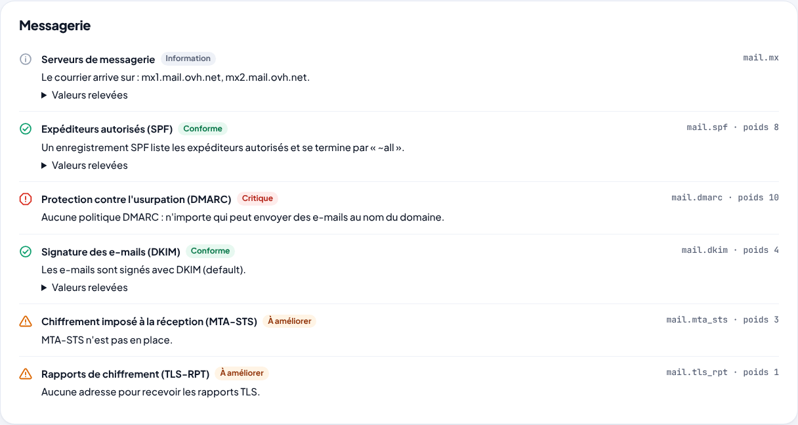

<div align="center">

# 🛡️ Posture Cockpit

### Votre domaine est-il bien protégé ? Et que corriger en premier ?

**Messagerie · Certificats · Site web · DNS · Plan de corrections guidé · Rapport PDF · Double authentification · Extensions**

🇬🇧 [Read in English](README.md)

<br>


<sub>Les captures montrent un domaine fictif de démonstration (<code>menuiserie-dupont.example</code>). Les adresses viennent des plages réservées à la documentation.</sub>

<br><br>

**Auto-hébergé · Analyse passive · Bilingue (FR / EN) · Références ANSSI et RFC · Open source pour un usage non commercial**

</div>

---

## 🚀 En bref

<table>
<tr>
<td width="33%" valign="top"><b>🧭 Un plan, pas une liste d'alertes</b><br>Les corrections sont classées par effet sur la note, avec le temps qu'elles prennent et qui doit les faire.</td>
<td width="33%" valign="top"><b>🪜 Pas à pas, chez votre hébergeur</b><br>OVHcloud, Gandi, IONOS, Cloudflare : l'hébergeur DNS est détecté et les instructions suivent ses menus. L'enregistrement est prêt à copier.</td>
<td width="33%" valign="top"><b>✅ « Vérifier » en un clic</b><br>Une fois la correction faite, le contrôle est relancé aussitôt et la note se met à jour.</td>
</tr>
<tr>
<td valign="top"><b>✉️ Le message au prestataire, déjà écrit</b><br>Ce qui ne se règle pas soi-même part en un message prêt à envoyer à l'agence web ou à l'informaticien.</td>
<td valign="top"><b>📄 Un rapport PDF comme un dossier d'expert</b><br>Le diagnostic en clair, l'ordonnance, le bilan par domaine, et une annexe technique avec les références.</td>
<td valign="top"><b>🧩 Extensible</b><br>Chaque famille de contrôles est une extension. Un paquet Python suffit pour en ajouter.</td>
</tr>
</table>

---

## ✨ Pour qui ?

Pour la petite entreprise, l'association, l'artisan ou la collectivité qui a un nom de domaine, une messagerie et un site, mais pas d'équipe sécurité. Et pour la personne qui les aide : l'informaticien de la famille, le prestataire, le consultant.

Les outils en ligne qui « notent » un domaine donnent une liste de défauts en anglais technique, puis s'arrêtent là. Posture Cockpit va jusqu'au bout : il dit **quoi faire, dans quel ordre, où cliquer**, vérifie que c'est fait, et produit un rapport à transmettre.

---

## 🧭 Le plan guidé

<table>
<tr>
<td width="55%" valign="top">


</td>
<td width="45%" valign="top">

### Chaque correction, expliquée

- **Pourquoi c'est important**, en une phrase sans jargon ;
- **le constat** : ce qui a été relevé ;
- **les étapes chez votre hébergeur DNS**, détecté à partir des serveurs de noms (vous pouvez en choisir un autre) ;
- **l'enregistrement à ajouter**, avec un bouton « Copier » pour le nom et pour la valeur ;
- une **précaution** quand il y en a une (par exemple : DMARC commence en observation, sans rien bloquer) ;
- le bouton **« J'ai fait la modification — vérifier »**.

Les corrections à déléguer (certificat, en-têtes du site, versions de TLS) donnent un **message prêt à envoyer**, à copier ou à ouvrir dans votre messagerie.

</td>
</tr>
</table>

---

## 📄 Le rapport PDF

<table>
<tr>
<td width="50%"></td>
<td width="50%"></td>
</tr>
</table>

Page 1 pour la personne qui décide : la note, le diagnostic en français courant et **l'ordonnance** (qui fait quoi, en combien de temps, avant quelle date). Page 2 : le bilan par domaine et les améliorations sans urgence. En annexe, pour l'informaticien : chaque contrôle, ce qui a été relevé et ses **références (ANSSI, RFC)**. Le nom imprimé au bas du dossier se règle dans l'administration.

---

## 🔎 Ce qui est contrôlé

| Domaine | Contrôles |
|---|---|
| **Messagerie** | SPF (avec le compte des requêtes DNS, limite de 10), DMARC (politique, pourcentage), DKIM (sélecteurs courants, longueur de clé), MTA-STS, rapports TLS (TLS-RPT), serveurs MX |
| **Certificats et TLS** | Validité et échéance du certificat (domaine et www), versions de TLS acceptées (1.0 et 1.1 obsolètes, 1.3 recommandé), longueur de clé |
| **Site web** | Redirection vers HTTPS, HSTS, Content-Security-Policy, protection contre l'intégration, nosniff, Referrer-Policy, versions de logiciels affichées, security.txt |
| **DNS** | Nombre de serveurs de noms, signature DNSSEC, enregistrements CAA (avec la valeur adaptée à l'autorité du certificat actuel) |

La note va de 0 à 100. Chaque contrôle a un poids selon son importance ; un point à améliorer compte pour moitié, un point critique pour zéro. **Un contrôle qui n'a pas pu être vérifié ne compte pas** : une panne réseau ne fait jamais baisser la note.



---

## 🕊️ Une analyse passive

Posture Cockpit ne fait que ce que fait n'importe quel visiteur : des requêtes DNS publiques, une poignée de main TLS, la lecture de la page d'accueil (et de quelques fichiers publics comme `security.txt`). **Pas de scan de ports, pas de test d'intrusion, rien n'est modifié.** Ses requêtes HTTP se présentent avec un User-Agent qui renvoie vers ce dépôt.

Si le serveur DNS utilisé ne répond pas correctement (certains résolveurs filtrants renvoient des réponses vides), l'analyse est refusée plutôt que de signaler à tort des enregistrements « manquants ».

---

## 🔐 Sécurité de l'application

- **Double authentification** : code TOTP (RFC 6238) après le mot de passe, codes de secours à usage unique, les autres navigateurs déconnectés à chaque changement ;
- **comptes multiples** : l'administrateur crée les comptes, chacun choisit son mot de passe à la première connexion ; les pages d'administration redemandent le mot de passe toutes les 10 minutes ;
- mots de passe en **scrypt**, clés d'API et codes de secours stockés hachés, **jeton CSRF** sur chaque formulaire, essais limités ;
- **politique de sécurité du contenu stricte** : aucun script ni style en ligne, rien n'est chargé depuis l'extérieur (polices comprises) ;
- image Docker sans privilèges, système de fichiers en lecture seule.

Voir [SECURITY.md](SECURITY.md).

---

## 🐳 Installation

```yaml
# compose.yaml
services:
  posture-cockpit:
    image: ghcr.io/vinzgithub/posture-cockpit:latest
    container_name: posture-cockpit
    restart: unless-stopped
    ports: ["8080:8080"]
    volumes: ["posture-cockpit-data:/data"]
volumes:
  posture-cockpit-data:
```

```bash
docker compose up -d
```

Ouvrez `http://<serveur>:8080`, créez le compte administrateur, et cochez **« Analyser le domaine de démonstration »** pour découvrir l'outil. Tous les réglages, la sauvegarde et la mise à jour : [docs/user/INSTALLATION.fr.md](docs/user/INSTALLATION.fr.md).

### En ligne de commande

```bash
posture-cockpit scan mon-domaine.fr          # le résultat dans le terminal (rien n'est enregistré)
posture-cockpit scan mon-domaine.fr --json
posture-cockpit extensions                   # les extensions chargées et leurs contrôles
posture-cockpit disable-totp <identifiant>   # téléphone perdu et plus de codes de secours
```

---

## 🏠 Home Assistant et supervision

Une clé d'API (Réglages → Clés d'API) donne accès à :

- `GET /api/v1/domains` : la note, la lettre, le nombre de points critiques et les jours restants avant l'échéance du certificat, pour chaque domaine ;
- `POST /api/v1/domains/<domaine>/scan` : relance l'analyse, par exemple chaque mois depuis une automatisation.

Exemples de capteurs et d'automatisation : [docs/user/HOME_ASSISTANT.fr.md](docs/user/HOME_ASSISTANT.fr.md).

---

## 🧩 Extensions

Les contrôles intégrés (messagerie, TLS, site web, DNS) sont eux-mêmes des extensions, écrites exactement comme celles que vous pouvez ajouter :

```python
extension = Extension("example", name="Exemple", version="1.0.0", messages=...)

@extension.check("permissions_policy", category="web", weight=1)
async def permissions_policy(ctx: CheckContext) -> Outcome:
    page = await ctx.net.http_get(f"https://{ctx.domain}/")
    if page.header("permissions-policy"):
        return ok("example.permissions_policy.ok")
    return warn("example.permissions_policy.missing", Remedy(10, Effort.DELEGATE, message="..."))
```

Un paquet Python qui déclare un point d'entrée `posture_cockpit.extensions` est chargé au démarrage ; l'administrateur peut l'activer ou le désactiver. Un exemple complet, testé, est dans [examples/posture-cockpit-example](examples/posture-cockpit-example). Le guide : [docs/developer/EXTENSIONS.fr.md](docs/developer/EXTENSIONS.fr.md).

---

## 🏗️ Pour les développeurs

Le code est découpé en couches qui ne se connaissent que dans un sens : le **moteur** (`core`) ne sait rien du web, les **contrôles** ne parlent au réseau qu'à travers quatre questions passives, le **stockage** n'a qu'une connexion SQLite et un dépôt par sujet, et chaque zone de l'**interface** a son module de routes. Tout est typé, vérifié par `ruff` et `mypy`, et couvert par plus de 130 tests qui tournent sans réseau.

Le plan détaillé : [docs/developer/ARCHITECTURE.fr.md](docs/developer/ARCHITECTURE.fr.md).

```bash
pip install -e ".[dev]"
ruff check src tests examples && mypy && pytest
```

---

## ⚠️ Limites connues

- **DKIM** : les sélecteurs ne se listent pas. Posture Cockpit essaie les noms les plus courants ; s'il n'en trouve aucun, c'est une information, pas une faute.
- **Instructions par hébergeur** : les menus des hébergeurs changent. Si une étape ne correspond plus, signalez-le : ce sont de simples textes dans `locales/`.
- **Analyses programmées** : pas encore intégrées à l'application ; utilisez l'API depuis Home Assistant ou cron.

---

## 📜 Licence

Posture Cockpit est publié sous la **[PolyForm Noncommercial License 1.0.0](LICENSE)** : libre pour un usage personnel, associatif, éducatif ou de recherche. Tout usage commercial (vente, hébergement payant, audits ou prestations facturés à partir de l'outil…) demande une licence écrite séparée : voir [COMMERCIAL-LICENSE.md](COMMERCIAL-LICENSE.md).

Copyright © 2026 Vincent Fournet.

Ce projet est développé avec l'assistance de Claude (Anthropic).
