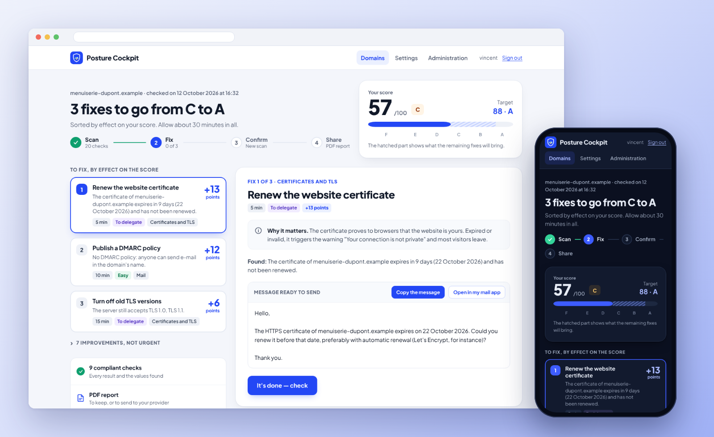
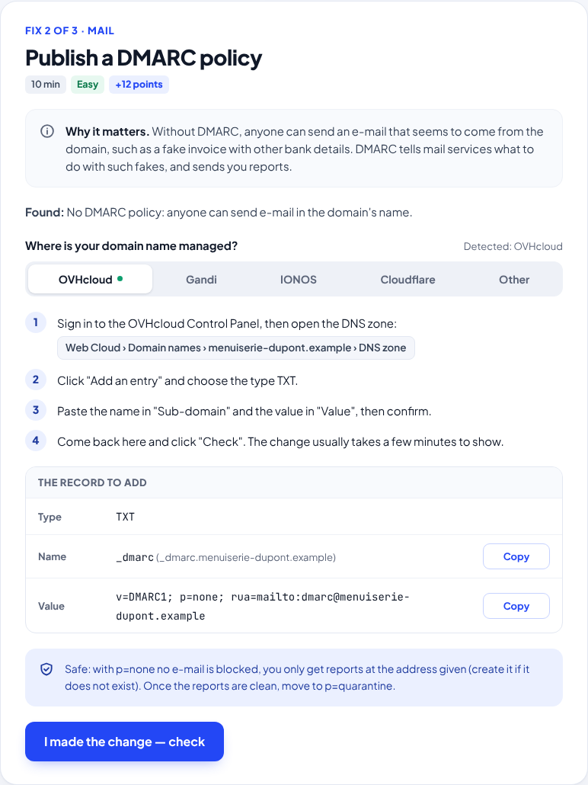
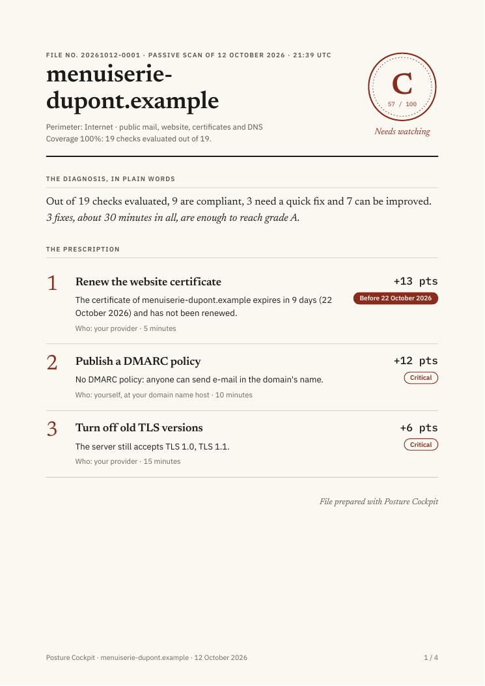
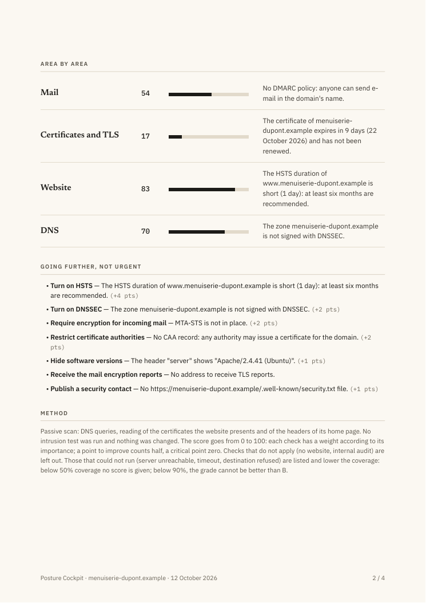
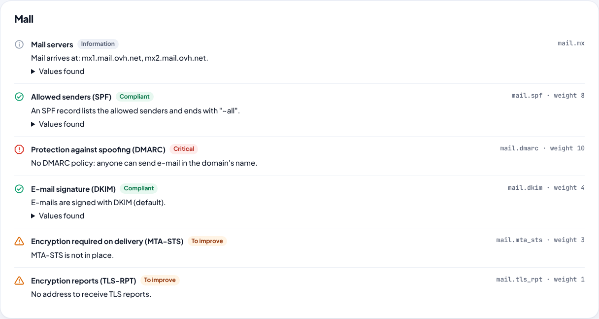

<div align="center">

# 🛡️ Posture Cockpit

### Is your domain well protected? And what should you fix first?

**Mail · Certificates · Website · DNS · Guided plan of fixes · PDF report · Two-factor authentication · Extensions**

🇫🇷 [Lire en français](README.fr.md)

<br>



<sub>The screenshots show a fictitious demo domain (<code>menuiserie-dupont.example</code>). Addresses come from the ranges reserved for documentation.</sub>

<br><br>

**Self-hosted · Passive checks · Bilingual (FR / EN) · ANSSI and RFC references · Open source for non-commercial use**

</div>

---

## ⚡ Quick start — Docker

**Posture Cockpit v0.5.0 installs without Git, Python or a local build.** Docker Engine and Docker Compose 2.24+ are required. The official GHCR image supports AMD64 and ARM64.

```bash
mkdir posture-cockpit && cd posture-cockpit
curl -fsSLO https://raw.githubusercontent.com/vinzgithub/posture-cockpit/v0.5.0/compose.yaml
docker compose up -d
```

Get the one-time first-account setup code with `docker compose logs posture-cockpit`, then visit `http://<server>:8080/setup` to create the administrator account. **Do not expose the service publicly over plain HTTP**: configure an HTTPS reverse proxy for remote access.

Configuration uses an optional [`.env` file](.env.example). For upgrades, backups, restore and rollback, follow the [installation guide](docs/user/INSTALLATION.md). The image is pinned to **0.5.0**, so an installation will not silently upgrade. **For existing v0.4.1 installations, do not use these new-install commands as an upgrade:** first [export a verified backup and follow the migration guide](docs/user/INSTALLATION.md#updating). Set `POSTURE_COCKPIT_SCHEDULER=off` before the first upgraded start; schema 5 requires restoration of the schema-4 backup to roll back.

### What's new in v0.5.0

- **Historical comparisons:** view comparable score and security-check changes without recalculating past assessments.
- **Scheduled scans:** daily, weekly and monthly schedules, administrator-controlled, with time-zone handling and execution history.
- **Internal events and alerts:** security regressions, meaningful score drops, coverage losses and repeated scheduled-scan failures, with open/resolved state and a personal unread indicator. No email or external alerts are sent.
- **SQLite schema 5:** immutable scan states, schedules and events, with a verified pre-migration backup.
- **Compatibility:** scoring rules and existing API fields are preserved, with version-pinned AMD64/ARM64 Docker images.

See the [v0.5.0 release notes](https://github.com/vinzgithub/posture-cockpit/releases/tag/v0.5.0).


---

## 🚀 At a glance

<table>
<tr>
<td width="33%" valign="top"><b>🧭 A plan, not a list of alerts</b><br>Fixes are sorted by their effect on the score, with the time they take and who should make them.</td>
<td width="33%" valign="top"><b>🪜 Step by step, at your DNS host</b><br>OVHcloud, Gandi, IONOS, Cloudflare: the DNS host is detected and the steps follow its menus. The record is ready to copy.</td>
<td width="33%" valign="top"><b>✅ "Check" in one click</b><br>Once a fix is made, the check runs again at once and the score updates.</td>
</tr>
<tr>
<td valign="top"><b>✉️ The message to your provider, already written</b><br>What you do not fix yourself goes out as a ready-to-send message to the web agency or the IT person.</td>
<td valign="top"><b>📄 A PDF report like an expert's file</b><br>The diagnosis in plain words, the prescription, area by area, and a technical annex with references.</td>
<td valign="top"><b>🧩 Extensible</b><br>Each family of checks is an extension. A Python package is enough to add one.</td>
</tr>
</table>

---

## ✨ Who is it for?

For the small business, association, craftsman or town hall that has a domain name, a mailbox and a website, but no security team. And for whoever helps them: the family's IT person, the provider, the consultant.

Online tools that "grade" a domain give a list of defects in technical English, and stop there. Posture Cockpit goes all the way: it says **what to do, in which order, where to click**, checks that it is done, and produces a report to hand over.

---

## 📈 History, scheduled scans and events

Posture Cockpit compares **compatible measured states** over time without rewriting old scores. Administrators can schedule recurring scans, and the **Events** page shows regressions, loss of observation coverage and resolutions, limited to each user's access rights. This is an internal dashboard, not an email notification service.

More details: [Scheduled scans](docs/user/ANALYSES_PROGRAMMEES.md) · [Events and alerts](docs/user/EVENEMENTS.md).

---

## 🧭 The guided plan

<table>
<tr>
<td width="55%" valign="top">



</td>
<td width="45%" valign="top">

### Every fix, explained

- **Why it matters**, in one sentence without jargon;
- **what was found**;
- **the steps at your DNS host**, detected from the name servers (you can pick another one);
- **the record to add**, with a "Copy" button for the name and for the value;
- a **precaution** when there is one (for instance: DMARC starts in monitoring mode, blocking nothing);
- the **"I made the change — check"** button.

Fixes to delegate (certificate, website headers, TLS versions) come with a **ready-to-send message**, to copy or to open in your mail app.

</td>
</tr>
</table>

---

## 📄 The PDF report

<table>
<tr>
<td width="50%"></td>
<td width="50%"></td>
</tr>
</table>

Page 1 is for the decision-maker: the grade, the diagnosis in plain words and **the prescription** (who does what, how long it takes, before which date). Page 2: area by area, and the improvements that are not urgent. In the annex, for the technician: every check, what was found and its **references (ANSSI, RFC)**. The name printed at the bottom of the file is set in the administration.

---

## 🔎 What is checked

| Area | Checks |
|---|---|
| **Mail** | SPF (RFC 7208 syntax, includes, limit of 10 DNS lookups), DMARC (policy, RFC 7489 syntax, subdomains, policy inherited from the parent domain), DKIM (usual selectors, readable keys, length), MTA-STS (policy read over valid HTTPS, fields, MX servers covered), TLS reports (TLS-RPT), reachable MX servers |
| **Certificates and TLS** | Certificate validity and expiry (domain and www), accepted TLS versions (1.0 and 1.1 obsolete, 1.3 recommended), key length |
| **Website** | Redirect to HTTPS, HSTS, Content-Security-Policy (that really restricts scripts), framing protection (value of frame-ancestors and X-Frame-Options), nosniff, Referrer-Policy, software versions shown, security.txt (RFC 9116) |
| **DNS** | Name servers and DNSSEC of the zone, CAA records (inherited ones too, and compatible with the authority of the current certificate) |

The score goes from 0 to 100. Each check has a weight according to its importance; a point to improve counts half, a critical point zero. It always comes with its **coverage**: the share of the applicable checks that could run. A check that could not be done (silent server, timeout) is neither a success nor a failure: it lowers the coverage. **Below 50% coverage the domain is "Not evaluated"**; below 90%, the grade cannot be better than B. The details: [docs/user/SCORING.md](docs/user/SCORING.md).



---

## 🕊️ A passive scan

Posture Cockpit only does what any visitor does: public DNS queries, a TLS handshake, reading the home page (and a few public files such as `security.txt`). **No port scan, no intrusion test, nothing is changed.** Its HTTP requests carry a User-Agent that points to this repository.

If the DNS resolver in use does not answer properly (some filtering resolvers return empty answers), the scan is refused rather than reporting "missing" records by mistake.

Every connection goes through an **egress rule**: on the Internet, only public addresses are contacted, on ports 80 and 443, after a single DNS resolution per scan and a check of the address actually contacted (IPv4 and IPv6), redirections included. Posture Cockpit therefore cannot be used to probe the local network or the metadata services of the server that hosts it.

---

## 🏢 Internal networks

Posture Cockpit can also audit sites of your private network (intranet, internal applications over HTTPS), in an **internal perimeter**:

- off by default, it must be allowed at start-up (`POSTURE_COCKPIT_INTERNAL_SCANS=true`), then an administrator describes each perimeter: allowed networks, internal DNS servers, ports, internal certificate authority;
- the scan only reaches those networks; certificate verification stays on, the internal CA is added to the trusted authorities;
- only administrators see these domains; every scan is written to the audit log and the PDF report is marked "Restricted distribution".

Setting up: [docs/user/INSTALLATION.md](docs/user/INSTALLATION.md#audits-of-internal-networks).

---

## 🔐 Application security

- **Two-factor authentication**: a TOTP code (RFC 6238) after the password, single-use recovery codes, other browsers signed out on every change;
- **several accounts**: the administrator creates accounts, each person chooses their password at first sign-in; administration pages ask for the password again every 10 minutes;
- **scrypt** password hashes, API keys and recovery codes stored hashed, a **CSRF token** on every form, attempts limited by address and by account;
- **audit log**: sign-ins, changes to accounts and settings, scans and the perimeter used;
- **limited scans**, at once and per account, with bounded time and number of requests;
- **strict Content Security Policy**: no inline script or style, nothing loaded from elsewhere (fonts included);
- unprivileged Docker image, read-only file system.

See [SECURITY.md](SECURITY.md).

---

## 🐳 Installation

Docker Compose 2.24 or later, in an empty folder:

```bash
mkdir posture-cockpit && cd posture-cockpit
curl -fsSLO https://raw.githubusercontent.com/vinzgithub/posture-cockpit/v0.5.0/compose.yaml
docker compose up -d
docker compose logs posture-cockpit   # the setup code of the first account
```

Open `http://<server>:8080/setup`, enter the code, create the administrator account, and tick **"Check the demo domain"** to discover the tool. The image is prebuilt (amd64 and arm64), versioned, unprivileged and read-only; settings (port, time zone, reverse proxy) go in an optional `.env` file. Settings, backups, restoring, updates and rollback: [docs/user/INSTALLATION.md](docs/user/INSTALLATION.md).

### From the command line

```bash
posture-cockpit scan my-domain.com          # the result in the terminal (nothing is saved)
posture-cockpit scan my-domain.com --json
posture-cockpit extensions                  # the extensions loaded and their checks
posture-cockpit disable-totp <username>     # lost phone and no recovery code left
posture-cockpit backup --output backup.tar.gz   # consistent backup (database and session key)
```

---

## 🏠 Home Assistant and monitoring

An API key (Settings → API keys) gives access to:

- `GET /api/v1/domains`: score (or `null` when the domain is not evaluated), grade, coverage, number of critical points and days left before the certificate expires, for every domain;
- `POST /api/v1/domains/<domain>/scan`: runs the scan again, for instance every month from an automation.

Sensor and automation examples: [docs/user/HOME_ASSISTANT.md](docs/user/HOME_ASSISTANT.md).

---

## 🧩 Extensions

The built-in checks (mail, TLS, website, DNS) are themselves extensions, written exactly like the ones you can add:

```python
extension = Extension("example", name="Example", version="1.0.0", messages=...)

@extension.check("permissions_policy", category="web", weight=1)
async def permissions_policy(ctx: CheckContext) -> Outcome:
    page = await ctx.net.http_get(f"https://{ctx.domain}/")
    if page.header("permissions-policy"):
        return ok("example.permissions_policy.ok")
    return warn("example.permissions_policy.missing", Remedy(10, Effort.DELEGATE, message="..."))
```

A Python package that declares a `posture_cockpit.extensions` entry point is loaded at start-up; the administrator can turn it on or off. A complete, tested example is in [examples/posture-cockpit-example](examples/posture-cockpit-example). The guide: [docs/developer/EXTENSIONS.md](docs/developer/EXTENSIONS.md).

---

## 🏗️ For developers

The code is split into layers that only know each other in one direction: the **engine** (`core`) knows nothing about the web, **checks** only reach the network through four passive questions, **storage** has one SQLite connection and one repository per subject, and each area of the **interface** has its own module of routes. Everything is typed, checked by `ruff` and `mypy`, and covered by more than 400 tests that reach no other machine (the network tests run against DNS, web and TLS servers started locally).

The detailed map: [docs/developer/ARCHITECTURE.md](docs/developer/ARCHITECTURE.md).

```bash
pip install -e ".[dev]"
ruff check src tests examples && mypy && pytest
```

---

## ⚠️ Known limits

- **DKIM**: selectors cannot be listed. Posture Cockpit tries the most common names; finding none is information, not a fault.
- **DNS host steps**: hosts change their menus. If a step no longer matches, please report it: these are plain texts in `locales/`.
- **Scheduled scans**: built into v0.5.0; the scheduler is enabled by default, so explicitly set `POSTURE_COCKPIT_SCHEDULER=off` during the first upgrade from v0.4.1.
- **Internal perimeters**: the instance must reach the internal network itself. The same name cannot be followed both from the Internet and in an internal perimeter. An agent architecture to audit several networks is being studied ([REMOTE_AGENT.md](docs/developer/REMOTE_AGENT.md)).
- **Behind a mandatory HTTP proxy**: scans do not go through a proxy (it would make the egress rule useless).

---

## 📜 License

Posture Cockpit is released under the **[PolyForm Noncommercial License 1.0.0](LICENSE)**: free for personal, non-profit, educational or research use. Any commercial use (selling, paid hosting, audits or services billed using the tool…) needs a separate written license: see [COMMERCIAL-LICENSE.md](COMMERCIAL-LICENSE.md).

Copyright © 2026 Vincent Fournet.

**Concept, project direction and validation: Vincent Fournet.**

As the originator of the project and its ideas, he defines its requirements, features and design direction. He also performs real-world testing, identifies issues, validates fixes and improvements, and reviews and checks selected parts of the code, particularly technical and security-related aspects within his expertise.

**Development:** carried out with the assistance of artificial intelligence tools, under his direction.
